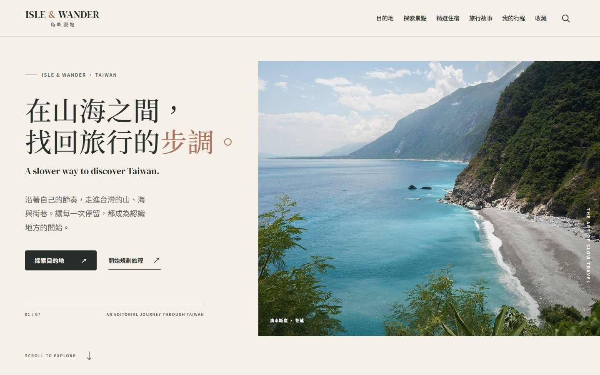
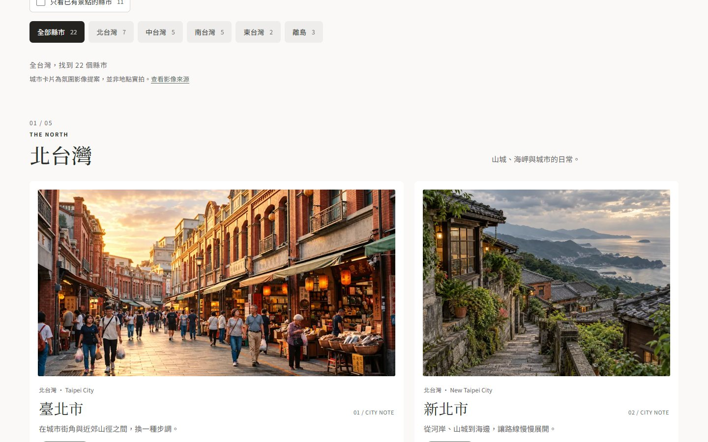
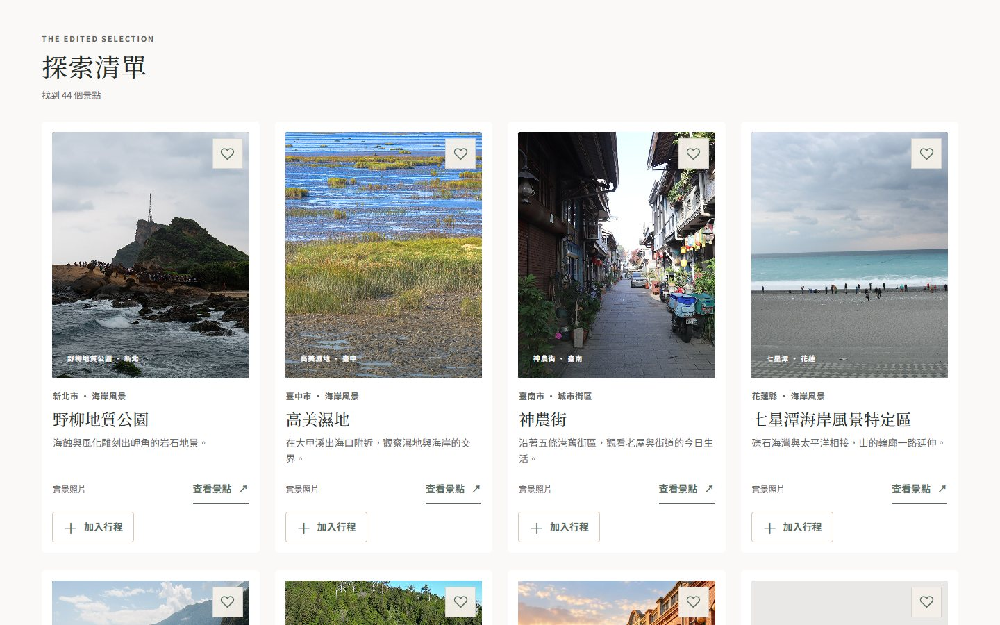
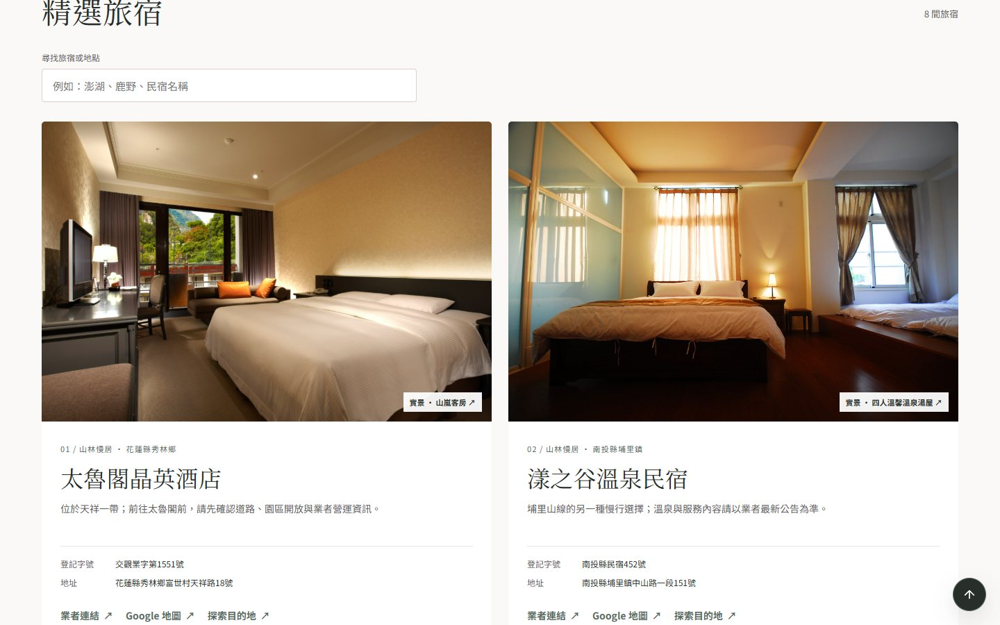
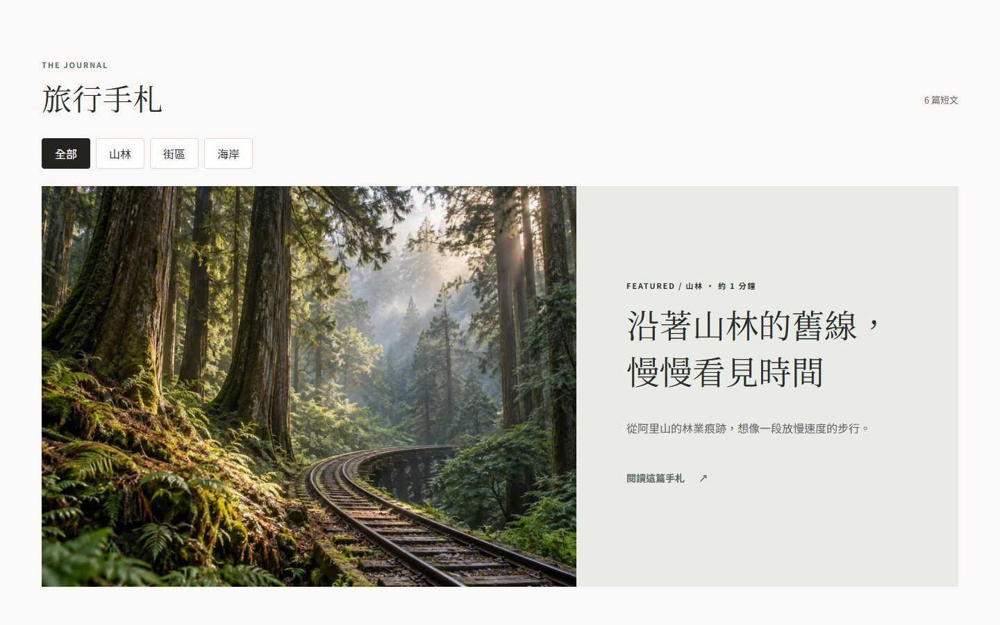
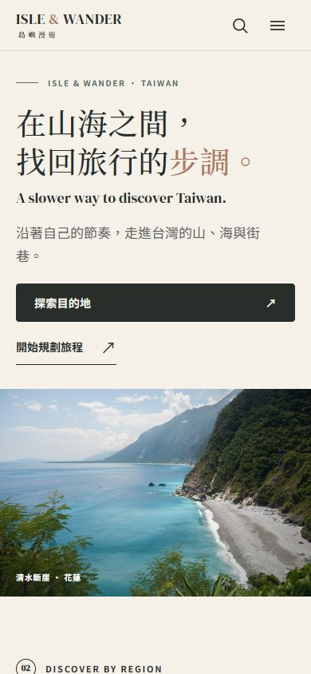
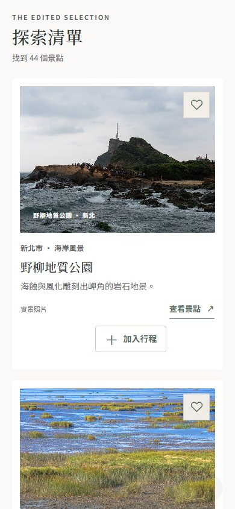
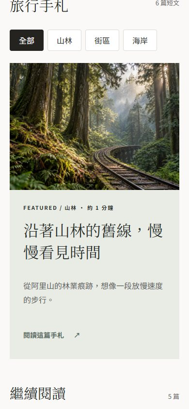

# ISLE & WANDER／島嶼漫遊

一個以臺灣慢旅行為題的 Vue 3 前端作品集。從目的地、景點與旅宿出發，把感興趣的景點收藏起來，再編排成自己的多日行程。

> 這是作品集 Demo：資料為編輯選輯，沒有訂房、付款、帳號或雲端同步功能。



## 畫面展示

| 目的地 · 依區域尋找縣市 | 探索景點 · 搜尋與篩選 |
| --- | --- |
|  |  |

| 精選旅宿 · 實際房型照片 | 旅行故事 · 主題手札 |
| --- | --- |
|  |  |

手機版也保留同樣的閱讀與操作流程：

| 首頁 | 景點列表 | 旅行故事 |
| --- | --- | --- |
|  |  |  |

以上為 2026-10-31 在本機開發環境截取的畫面。景點與旅宿資訊可能隨來源更新；影像的實景／概念區分與授權標示見[素材與資料來源](src/views/SourcesView.vue)。

## 目前可操作的內容

| 頁面 | 功能 |
| --- | --- |
| [目的地](src/views/DestinationsView.vue) | 瀏覽 22 縣市、依旅遊區域篩選、搜尋城市、只看已有景點的縣市。 |
| [探索景點](src/views/ExploreView.vue) | 瀏覽 44 筆精選景點，依縣市、類型與關鍵字篩選；可進入景點詳情、收藏或加入行程。 |
| [精選旅宿](src/views/StaysView.vue) | 依風格與地點尋找 8 間旅宿，查看登記資訊、業者連結及 Google 地圖。沒有價格、空房或訂房功能。 |
| [旅行故事](src/views/StoriesView.vue) | 閱讀 6 篇短篇手札，依山林、街區、海岸切換主題；內頁提供閱讀進度與相關景點入口。 |
| [收藏與行程](src/views/PlannerView.vue) | 在本機瀏覽器收藏景點、建立 1–7 天行程、調整每日順序及跨日移動；可匯出／匯入 JSON 備份。 |

## 本機執行

需要 Node.js 與 npm。安裝依賴後啟動 Vite，開啟終端機顯示的本機網址：

```powershell
npm install
npm run dev -- --port 5173 --strictPort
```

在 Windows PowerShell 若 `npm.ps1` 被執行原則阻擋，可改用 `npm.cmd`；不需修改系統執行原則。

```powershell
npm.cmd install
npm.cmd run dev -- --port 5173 --strictPort
```

建置與資料檢查：

```powershell
npm run build
npm run data:validate
```

## 技術與專案結構

- **Vue 3、TypeScript、Vite**：頁面與建置。
- **Vue Router**：目的地、景點、旅宿、故事與行程路由。
- **Pinia + localStorage**：景點收藏及行程資料；儲存被停用時僅保留於本次瀏覽。
- `src/views/` 放頁面，`src/components/` 放共用元件，`src/data/` 放靜態資料與影像對照，`src/styles/` 放版面與設計樣式。
- `docs/` 保留設計、資料來源與階段紀錄；`docs/screenshots/` 是本 README 使用的本機截圖。

行程資料只存在目前瀏覽器，不會自動同步到手機或其他電腦。JSON 備份的格式與匯入限制見[行程進階功能紀錄](docs/PHASE3CD-STATUS.md)。

## 資料與影像

景點資料精選自交通部觀光署的[景點－觀光資訊資料庫](https://data.gov.tw/dataset/7777)；旅宿資訊與卡片房型照片取自[旅館民宿－觀光資訊資料庫](https://data.gov.tw/dataset/7780)。部分景點照片另有 Wikimedia Commons 授權紀錄。城市意象、首頁旅宿風格與故事配圖中的生成影像為**概念提案，不是地點實拍**。

各筆影像出處、授權及編輯說明整理於[素材與資料來源頁](src/views/SourcesView.vue)與[景點資料來源紀錄](docs/PHASE2B-DATA-SOURCES.md)。出發、預訂或引用資料前，請再查詢來源網站的最新資訊。
